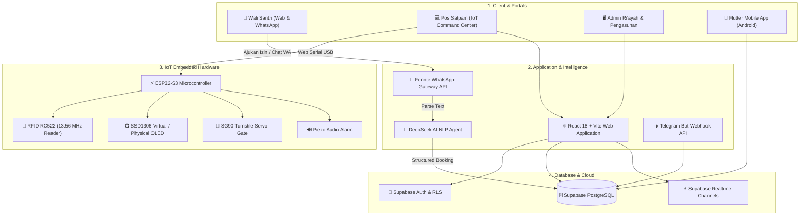

# 🕌 Smart Permit & Smart Ri'ayah v3.8
### *Integrated IoT Smart Gate, AI Autonomous Agent, RFID Cashless & Holistic Boarding School Governance System*

[](https://smart-riayah.vercel.app)
[](https://react.dev)
[](https://vitejs.dev)
[](https://tailwindcss.com)
[](https://supabase.com)
[](https://espressif.com)
[](https://deepseek.com)
[](https://flutter.dev)

---

## 📌 Ringkasan Eksekutif (Executive Summary)

**Smart Permit & Smart Ri'ayah** adalah platform tata kelola pesantren modern terpadu yang menggabungkan otomasi gerbang fisik (**IoT ESP32-S3 & RFID RC522 13.56 MHz**), kecerdasan buatan (**DeepSeek AI LLM**), gerbang perpesanan (**WhatsApp Gateway & Telegram Webhook**), sistem pembayaran nontunai santri (**RFID Cashless Ecosystem**), serta **8 Hak Akses Pengguna (Role-Based Access Control)** yang mencakup seluruh pemangku kepentingan pesantren.

Sistem ini mentransformasi perizinan santri konvensional yang sebelumnya berbasis surat kertas rentan hilang/dipalsukan menjadi ekosistem digital terenkripsi, transparan, dan real-time dari tangan wali santri hingga pos keamanan gerbang utama.

---

## 🌟 Fitur Unggulan (Core Pillars)

```
┌─────────────────────────────────────────────────────────────────────────────┐
│                       SMART PERMIT & SMART RI'AYAH                          │
├─────────────────────┬─────────────────────┬─────────────────────────────────┤
│   🔌 IoT Hardware   │  🤖 AI & WhatsApp   │  👥 Multi-Role Governance       │
│ • ESP32-S3 Serial   │ • DeepSeek LLM Bot  │ • 8 RBAC Portals                │
│ • RFID RC522 Tap    │ • Fonnte WA Gateway │ • Approval & Mutaba'ah          │
│ • OLED & Alarm Gate │ • E-Kupon QR Code   │ • Headcount & Executive DSS     │
└─────────────────────┴─────────────────────┴─────────────────────────────────┘
```

### 1. 🔌 IoT Smart Gate & Web Serial Hardware
- **Komunikasi Langsung Web Serial API**: Browser berkomunikasi langsung dengan mikrokontroler **ESP32-S3** melalui kabel USB Serial tanpa perlu driver tambahan.
- **RFID RC522 (13.56 MHz) Card Reader**: Pembacaan UID kartu cerdas santri dengan validasi instan terhadap database Supabase.
- **Virtual OLED SSD1306 & Gate Simulation**: Simulasi layar mini OLED pos satpam dan palang pintu putar (*turnstile gate*) interaktif dengan audio buzzer alert.
- **Alarm Deteksi Anti-Bypass & Overstay**: Sistem otomatis membunyikan sirene peringatan jika santri melewati batas jam kepulangan atau jika kartu yang belum diotorisasi di-tap di pos gerbang.

### 2. 🤖 Autonomous AI Agent & WhatsApp Gateway
- **Natural Language Permit Parsing (DeepSeek AI)**: Wali santri dapat mengajukan izin sambang/pulang cukup dengan mengetik pesan percakapan bebas di WhatsApp. Model AI otomatis mengekstrak nama santri, kelas, kamar, tanggal, jam kedatangan, dan bobot barang titipan.
- **Penerbitan E-Kupon & Barcode Resmi**: Begitu izin disetujui (atau auto-approval weekend), sistem otomatis mengirimkan tiket digital berformat **1D Barcode (Code 128)** & **2D QR Code** ke nomor WhatsApp orang tua.
- **Sistem Pengingat H-15 Menit**: Bot otomatis mengirim notifikasi peringatan ke WhatsApp wali santri 15 menit sebelum jam kunjungan berakhir.

### 3. 👥 Tata Kelola 8 Hak Akses Role (RBAC System)
Setiap pemangku kepentingan memiliki portal khusus yang disesuaikan dengan tanggung jawab operasional pondok:

| Role No. | Nama Role Portal | Persona Pengguna | Route Dashboard | Tanggung Jawab Utama |
| :---: | :--- | :--- | :--- | :--- |
| **01** | **Super Admin** | Ust. Eng. Al-Fatih, M.T. | `/dashboard/developer` | Konsol IoT Diagnostics, Web Serial Monitor, pinout GPIO, database schema & system audit. |
| **02** | **Admin Ri'ayah** | Ust. Drs. H. Mustofa | `/dashboard/admin` | Persetujuan surat izin santri, konfigurasi kuota kamar asrama, onboarding santri, dan manajemen kartu RFID. |
| **03** | **Musyrif / Musyrifah** | Ust. M. Syukron, M.Pd. | `/dashboard/musyrif` | Pembinaan adab, pencatatan poin pelanggaran & prestasi, mutaba'ah ubudiyah, inspeksi kamar asrama. |
| **04** | **Pos Satpam (Keamanan)** | Komandan Sutrisno | `/dashboard/gate` | Command Center gerbang, tap scan RFID, pemindai barcode kupon wali santri, audit timbangan barang. |
| **05** | **Medis UKS / Poskestren**| dr. Nurul Aini | `/dashboard/medical` | Rekam Medis Elektronik (RME), klinik rawat jalan, dispensasi istirahat kamar, auto-generate rujukan RS. |
| **06** | **Orang Tua / Wali Santri**| H. Bambang Sudarsono | `/dashboard/wali` | Portal mobile-first wali santri, pengajuan izin digital, pantauan setoran tahfidz, limit saldo RFID. |
| **07** | **Pimpinan (Mudir Ma'had)**| K.H. Ahmad Dahlan, Lc. | `/dashboard/mudir` | Executive Analytics, Decision Support System (DSS), grafik tren izin santri, headcount asrama pondok. |
| **08** | **Pengurus OSIS** | M. Farhan & Nur Laila | `/dashboard/osis` | Posko Kamtib & Ubudiyah, presensi shalat berjama'ah 5 waktu, ketertiban santri se-pondok. |

### 4. 📊 Manajemen Kunjungan & Analitik Real-Time
- **Live Headcount Pondok**: Indikator real-time jumlah tamu yang sedang berada di dalam area pesantren (*Live pulse indicator*).
- **Grafik Tren 7 Hari & Jam Kedatangan Teramai**: Visualisasi volume kedatangan (*AreaChart* & *BarChart* via Recharts) untuk memetakan jam operasional tersibuk (Pagi 08:30–11:30, Siang 11:30–14:30, Sore 14:30–17:30).
- **Distribusi Kunjungan per Asrama**: Pantauan sebaran santri yang dijenguk berdasarkan asrama putra (*Umar bin Khattab, Abu Bakar*) dan putri (*Khadijah, Siti Aisyah*).
- **Roster Rinci Tamu**: Kartu profil interaktif setiap tamu dengan live countdown sisa waktu berkunjung, foto inisial, dan pintasan chat WhatsApp.

---

## 🏗️ Arsitektur Sistem (System Architecture)



---

## 🛠️ Tech Stack & Ekosistem Teknologi

| Kategori | Teknologi | Deskripsi / Kegunaan |
| :--- | :--- | :--- |
| **Frontend Framework** | **React 18.3** | Single Page Application dengan arsitektur komponen modular. |
| **Build Tool** | **Vite 6** | Bundler ultra-cepat dengan Hot Module Replacement (HMR). |
| **Styling & UI** | **Tailwind CSS 3.4** | Utility-first CSS, responsive styling, dan custom animations. |
| **Icons & Visuals** | **Lucide React** | Ikon modern, minimalis, dan konsisten di seluruh dashboard. |
| **Charts & Analytics**| **Recharts 2.15** | Grafik visual interaktif (*AreaChart*, *BarChart*, *PieChart*). |
| **Database & Auth** | **Supabase (PostgreSQL)** | Relational database, Row-Level Security (RLS), & Realtime engine. |
| **AI LLM Engine** | **DeepSeek API** | Natural Language Processing untuk perizinan berbasis pesan WA. |
| **Messaging Gateway** | **Fonnte API** | Pengiriman WhatsApp Gateway barcode & notifikasi otomatis. |
| **IoT Hardware** | **ESP32-S3 + C++** | Mikrokontroler gerbang turnstile dengan Web Serial API. |
| **Mobile Client** | **Flutter / Dart** | Aplikasi Android mobile-first santri & wali santri (`flutter_client`). |
| **Hosting & CI/CD** | **Vercel Production** | Deployment edge global terotomasi dengan auto-ssl. |

---

## 📁 Struktur Direktori Project (Directory Structure)

```plaintext
smart-riayah/
├── api/                         # Serverless API endpoints & Webhooks
│   └── telegram/webhook.js      # Telegram Bot notification gateway
├── firmware/                    # Embedded hardware source code
│   └── esp32s3_smart_permit/    # C++/Arduino firmware untuk ESP32-S3 & RC522
├── flutter_client/              # Native Android application (Flutter/Dart)
│   ├── android/
│   └── lib/                     # Mobile-first student & parent interface
├── public/                      # Static assets, sound effects, images
├── server/                      # Express backend services & WA gateway
│   └── whatsapp-gateway/        # AI Autonomous responder engine
├── src/
│   ├── components/
│   │   ├── auth/                # Halaman otentikasi (LoginPage.jsx)
│   │   ├── common/              # Komponen barcode SVG, kartu, alert
│   │   ├── landing/             # Landing page modern (LandingPage.jsx)
│   │   ├── modules/             # Modul fungsional spesifik:
│   │   │   ├── EngageAiWorkspace.jsx       # Chat stream & AI handoff
│   │   │   ├── VisitBookingManager.jsx     # Manajemen kunjungan & Recharts
│   │   │   ├── RealtimeGateLogsManager.jsx # Log pintu gerbang real-time
│   │   │   ├── RfidCardManager.jsx         # Registrasi kartu RFID & limit
│   │   │   ├── PoskestrenClinic.jsx        # Rekam medis UKS pesantren
│   │   │   └── ExpressPermitKiosk.jsx      # Kiosk pengajuan izin kilat
│   │   └── roles/               # Dashboard spesifik untuk masing-masing role:
│   │       ├── SuperAdminDashboard.jsx     # Role 01: Super Admin
│   │       ├── AdminRiayahDashboard.jsx    # Role 02: Admin Ri'ayah
│   │       ├── MusyrifDashboard.jsx        # Role 03: Musyrif Asrama
│   │       ├── SecurityCommandCenter.jsx   # Role 04: Pos Satpam Gate
│   │       ├── ParentPortal.jsx            # Role 06: Wali Santri
│   │       └── OsisDashboard.jsx           # Role 08: OSIS Kamtib
│   ├── context/
│   │   └── AppContext.jsx       # State management global ekosistem
│   ├── services/
│   │   └── deepseekVisitService.js # Integrasi LLM parsing percakapan
│   └── utils/
│       ├── audio.js             # Sound FX (beep, success, alarm, access denied)
│       ├── barcodeUtils.js      # Generator QR Code & 1D Barcode Code 128
│       ├── csvUtils.js          # Export rekapitulasi audit laporan CSV
│       └── pondokTimeUtils.js   # Perhitungan waktu WITA & alarm overstay
├── package.json                 # Node dependencies & build scripts
└── vite.config.js               # Konfigurasi Vite & module aliasing
```

---

## 🚀 Panduan Memulai (Getting Started)

### Prasyarat (Prerequisites)
- [Node.js](https://nodejs.org/) v18.0.0 atau lebih baru
- Package Manager: `npm` atau `yarn`
- Proyek [Supabase](https://supabase.com/) aktif (PostgreSQL database)
- *(Opsional untuk hardware)*: Board ESP32-S3 + Modul RFID RC522 13.56 MHz

### 1. Clone Repositori
```bash
git clone https://github.com/miyatyy/smart-riayah.git
cd smart-riayah
```

### 2. Instalasi Dependensi
```bash
npm install
```

### 3. Konfigurasi Environment Variables
Buat file `.env` di root direktori dan sesuaikan parameter berikut:
```env
VITE_SUPABASE_URL=https://your-project.supabase.co
VITE_SUPABASE_ANON_KEY=your-supabase-anon-key
VITE_FONNTE_TOKEN=your-fonnte-whatsapp-token
VITE_DEEPSEEK_API_KEY=your-deepseek-api-key
```

### 4. Jalankan Aplikasi di Mode Development
```bash
npm run dev
```
Buka browser di `http://localhost:5173` untuk melihat aplikasi.

### 5. Build untuk Produksi
```bash
npm run build
```

---

## 🔒 Catatan Keamanan Portofolio (Portfolio Security Notice)

> [!NOTE]
> Untuk menjaga privasi dan keamanan sistem saat dijadikan showcase portofolio terbuka, **kredensial akun demo publik sengaja disembunyikan dari halaman antarmuka website**.
> Akses pengujian portofolio dapat dilakukan menggunakan dokumen kredensial privat (`Data_Akun_Demo_Smart_Riayah.pdf`) yang tersimpan secara lokal oleh pemilik sistem.

---

## 👨‍💻 Pengembang & Portofolio (Author)

Proyek ini dirancang dan dikembangkan sebagai representasi portofolio teknologi mutakhir dalam mengintegrasikan **IoT Hardware, Fullstack Web, Mobile App, dan Artificial Intelligence** untuk institusi pendidikan pesantren modern.

- **Developer**: Miyatyy
- **Repository**: [https://github.com/miyatyy/smart-riayah](https://github.com/miyatyy/smart-riayah)
- **Live Demo**: [https://smart-riayah.vercel.app](https://smart-riayah.vercel.app)
- **Sistem**: Pesantren Modern Darul Ulum • Smart Permit & Smart Ri'ayah v3.8

---

<p align="center">
  <b>© 2026 Smart Permit & Smart Ri'ayah. All rights reserved.</b><br>
  <i>Empowering Modern Pesantren with IoT, AI, and Cloud Innovation.</i>
</p>
